

  <picture><source media="(max-width: 640px)" srcset="assets/cards/hero-mobile.svg" /><source media="(prefers-color-scheme: dark)" srcset="assets/cards/hero-dark.svg" /></picture>

Frontend engineer with 8+ years of production experience. I build interfaces for hardware and software: self-checkout kiosks, autonomous cleaning robots, barcode scanners, online grocery, chatbot builders, and marketing platforms.

I work alone on a product or inside a team, at large companies and small ones.

## Where I've worked

  <picture><source media="(prefers-color-scheme: dark)" srcset="assets/cards/timeline-1-dark.svg" /></picture><!--
  --><picture><source media="(prefers-color-scheme: dark)" srcset="assets/cards/timeline-2-dark.svg" /></picture><!--
  --><picture><source media="(prefers-color-scheme: dark)" srcset="assets/cards/timeline-3-dark.svg" /></picture><!--
  --><picture><source media="(prefers-color-scheme: dark)" srcset="assets/cards/timeline-4-dark.svg" /></picture>

## What I built

  <picture><source media="(prefers-color-scheme: dark)" srcset="assets/cards/project-cash-dark.svg" /></picture><!--
  --><picture><source media="(prefers-color-scheme: dark)" srcset="assets/cards/project-robots-dark.svg" /></picture><!--
  --><picture><source media="(prefers-color-scheme: dark)" srcset="assets/cards/project-labels-dark.svg" /></picture><!--
  --><picture><source media="(prefers-color-scheme: dark)" srcset="assets/cards/project-grocery-dark.svg" /></picture><!--
  --><picture><source media="(prefers-color-scheme: dark)" srcset="assets/cards/project-chatbot-dark.svg" /></picture><!--
  --><a href="https://www.npmjs.com/package/onscan-next"><picture><source media="(prefers-color-scheme: dark)" srcset="assets/cards/project-onscan-dark.svg" /></picture></a>

Project details

- **Cash payments for 2,000+ self-checkout kiosks.** Added to software already running in stores, without replacing it. A real-time WebSocket layer covers 60+ hardware states and 10+ payment, maintenance, and diagnostic flows. Each kiosk handles about 300 cash transactions a day.
- **Fleet dashboard for 200+ autonomous cleaning robots.** Designed and built from scratch: 20+ screens for live status, routes, schedules, parts diagnostics, and field-engineer tasks, with role-based access.
- **Shelf label linking for retail stores.** A store app that links electronic shelf labels to products by barcode scanner, phone camera, or manual entry. Throughput rose from 6 to 7 labels per minute to about 50. Piloted in 12 stores.
- **Online grocery delivery frontend.** Catalog, product pages, and cart for a national retailer's digital arm. Handles 270,000+ orders on peak days.
- **No-code chatbot builder.** React and TypeScript frontend with a drag-and-drop flow editor, used by 200+ businesses across Russia and the CIS.
- **[onscan-next](https://www.npmjs.com/package/onscan-next).** Open-source (MIT) typed library for hardware barcode scanners. Works with React, Vue, and Angular, and includes a `simulate()` API for tests without a physical scanner. 
  
  
  

## By the numbers

  <picture><source media="(prefers-color-scheme: dark)" srcset="assets/cards/number-1-dark.svg" /></picture><!--
  --><picture><source media="(prefers-color-scheme: dark)" srcset="assets/cards/number-2-dark.svg" /></picture><!--
  --><picture><source media="(prefers-color-scheme: dark)" srcset="assets/cards/number-3-dark.svg" /></picture><!--
  --><picture><source media="(prefers-color-scheme: dark)" srcset="assets/cards/number-4-dark.svg" /></picture>

Store counts: X5 Group, as of December 31, 2025. Self-checkouts: estimated as a quarter of 25,533 Pyaterochka stores with three each. Cash payments: 2,000 kiosks at about 300 a day.

## Stack

  <picture><source media="(prefers-color-scheme: dark)" srcset="assets/cards/stack-core-dark.svg" /></picture><!--
  --><picture><source media="(prefers-color-scheme: dark)" srcset="assets/cards/stack-ui-dark.svg" /></picture><!--
  --><picture><source media="(prefers-color-scheme: dark)" srcset="assets/cards/stack-testing-dark.svg" /></picture>

## AI Tooling

  <picture><source media="(max-width: 640px)" srcset="assets/cards/ai-mobile.svg" /><source media="(prefers-color-scheme: dark)" srcset="assets/cards/ai-dark.svg" /></picture>

I set the team standard for AI development tools across four frontend projects. That covers Claude Code and OpenCode, internal webinars on both, and CodeRabbit for automated review. I also built an AI meeting-notes bot that saves several hours of manual work per week.

## Contact

  <a href="mailto:shockwave3301@proton.me"><picture><source media="(prefers-color-scheme: dark)" srcset="assets/cards/contact-email-dark.svg" /></picture></a><!--
  --><a href="https://t.me/shockwave3301"><picture><source media="(prefers-color-scheme: dark)" srcset="assets/cards/contact-telegram-dark.svg" /></picture></a><!--
  --><a href="mailto:shockwave3301@proton.me?subject=LinkedIn%20and%20CV%20request"><picture><source media="(prefers-color-scheme: dark)" srcset="assets/cards/contact-linkedin-dark.svg" /></picture></a>

**Email:** `shockwave3301@proton.me` · **Telegram:** `@shockwave3301`
