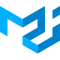

# Senior / Lead Frontend Engineer

Frontend engineer with 8+ years of production experience. I build interfaces for hardware and software: self-checkout kiosks, autonomous cleaning robots, barcode scanners, online grocery, chatbot builders, and marketing platforms.

I work alone on a product or inside a team, at large companies and small ones.

## What I build

- **Cash payments for 2,000+ self-checkout kiosks.** Added to software already running in stores, without replacing it. A real-time WebSocket layer covers 60+ hardware states and 10+ payment, maintenance, and diagnostic flows. Each kiosk handles about 300 cash transactions a day.
- **Fleet dashboard for 200+ autonomous cleaning robots.** Designed and built from scratch: 20+ screens for live status, routes, schedules, parts diagnostics, and field-engineer tasks, with role-based access.
- **Shelf label linking for retail stores.** A store app that links electronic shelf labels to products by barcode scanner, phone camera, or manual entry. Throughput rose from 6 to 7 labels per minute to about 50. Piloted in 12 stores.
- **Company design system.** About 20 reusable React and TypeScript components, documented in Storybook, covered by automated visual checks, and used across four projects.
- **Online grocery delivery frontend.** Catalog, product pages, and cart for a national retailer's digital arm. Handles 270,000+ orders on peak days.
- **No-code chatbot builder.** React and TypeScript frontend with a drag-and-drop flow editor, used by 200+ businesses across Russia and the CIS.
- **[onscan-next](https://www.npmjs.com/package/onscan-next).** Open-source (MIT) typed library for hardware barcode scanners. Works with React, Vue, and Angular, and includes a `simulate()` API for tests without a physical scanner.

## Results

| Result | Figure |
|---|---|
| Drop in error-related store complaints after on-screen hardware recovery | About 95% |
| Drop in new support tickets after FAQ and support flow redesign | About 30% |
| Average code review turnaround after CodeRabbit rollout | One day |
| Monthly savings from AI-generated Figma designs | About RUB 400,000 |

## Stack

  
  
  
  <picture><source media="(prefers-color-scheme: dark)" srcset="assets/icons/redux-dark.svg" /></picture>
  <picture><source media="(prefers-color-scheme: dark)" srcset="assets/icons/tanstack-dark.svg" /></picture>
  
  <picture><source media="(prefers-color-scheme: dark)" srcset="assets/icons/radixui-dark.svg" /></picture>
  
  
  
  
  
  <picture><source media="(prefers-color-scheme: dark)" srcset="assets/icons/vitest-dark.svg" /></picture>
  
  <picture><source media="(prefers-color-scheme: dark)" srcset="assets/icons/cypress-dark.svg" /></picture>
  <picture><source media="(prefers-color-scheme: dark)" srcset="assets/icons/vite-dark.svg" /></picture>
  <picture><source media="(prefers-color-scheme: dark)" srcset="assets/icons/webpack-dark.svg" /></picture>

- **Core:** TypeScript, JavaScript, React, Redux, TanStack Query and Router, REST APIs, WebSocket
- **UI:** Chakra UI, Radix, Material UI, CSS Modules, SASS, Storybook, Figma
- **Testing and tooling:** Vitest, Jest, Cypress, Mock Service Worker, Vite, Webpack

## AI-assisted development

  
  <picture><source media="(prefers-color-scheme: dark)" srcset="assets/icons/opencode-dark.svg" /></picture>
  

I set the team standard for AI development tools across four frontend projects. That covers Claude Code and OpenCode, internal webinars on both, and CodeRabbit for automated review. I also built an AI meeting-notes bot that saves several hours of manual work per week.

## Open to

Lead and senior frontend roles, remote, hybrid, or relocation. Reach me through the links on this profile.

Languages: English (C1), Russian (native).
